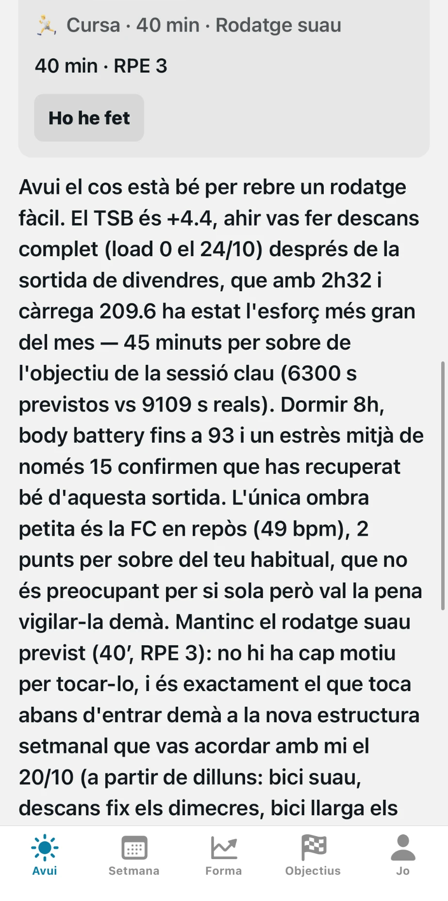
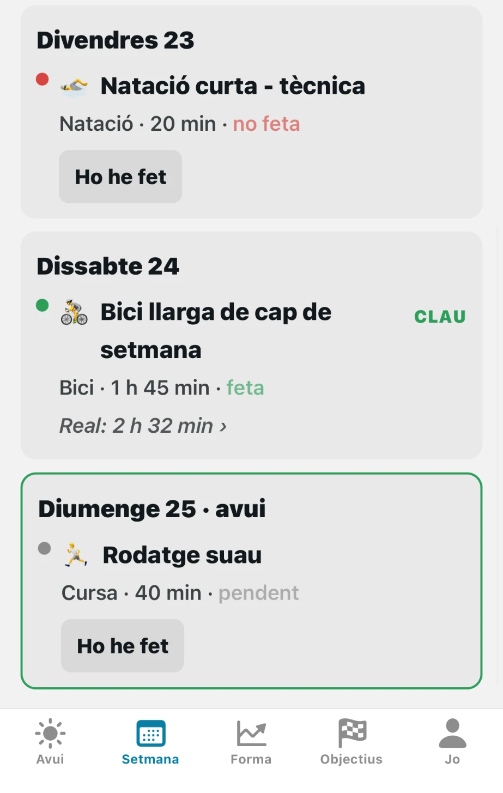
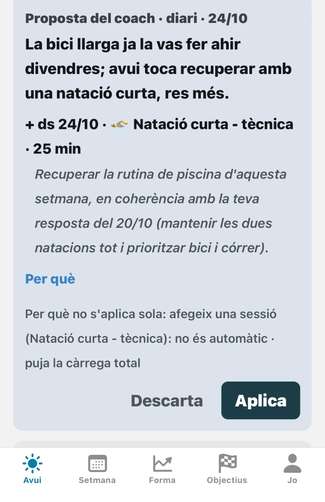
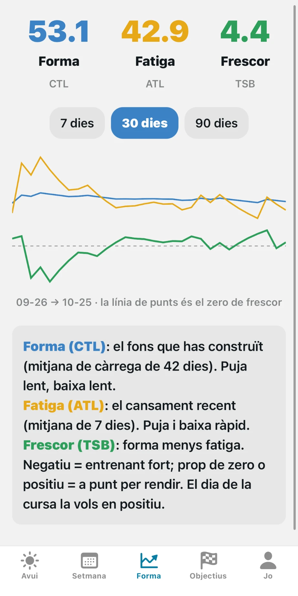
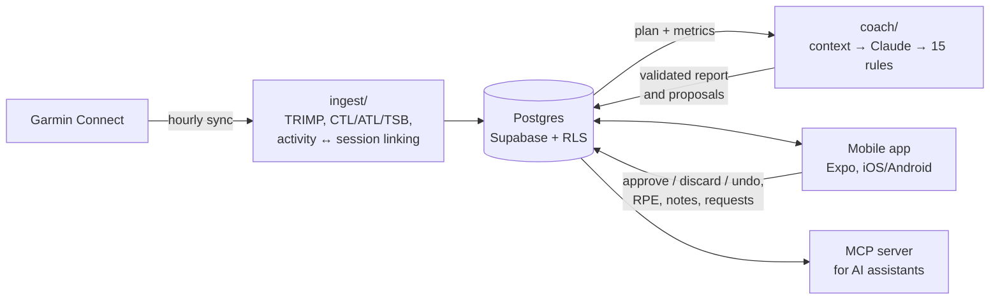

# Entrenador: an LLM triathlon coach with guardrails

[](https://github.com/roger-alles/triathlon-coach/actions/workflows/tests.yml)
[](LICENSE)

A personal, automatic triathlon coach I built for myself and have used every
day since September 2026. Each morning it reads my Garmin data (workouts,
sleep, resting heart rate, stress, body battery), compares it with a
structured training plan, and has Claude write the day's report: a traffic
light, what's on today, what it would change, and why. I read it, and approve
or reject the changes it proposes, in a native mobile app.

It got me to the finish line of my first triathlon (Artiem Half Menorca Short,
27/09/2026). It now plans my season on a rolling basis.

<p align="center">
  
  
  
  
</p>

## Why it's built this way

An LLM is good at reading messy context and explaining a decision. It is bad
at being reliably safe with someone's body. So the model never writes to the
plan directly:

- **The plan is data, not text.** Blocks, sessions with structure (warm-up,
  intervals, pace or RPE targets), priorities and tests live in Postgres,
  versioned with `superseded_by`. Nothing is ever deleted.
- **Structured output, then a validator that trusts nobody.** The model
  answers against a JSON Schema ([`contracts/`](contracts/)). Every proposal
  is then checked against 15 deterministic coaching rules
  ([`coach/rules.py`](coach/rules.py)): weekly ramp, deload cadence, spacing of
  key sessions, intensity distribution, rest days, taper, red flags from
  sleep and HR, the athlete's declared availability, and more. Six of them
  block a proposal; the rest are warnings.
- **Violations go back to the model.** It gets up to 3 attempts. If it still
  fails, the proposal is discarded, the plan stays as it was, and everything
  is logged.
- **Graduated autonomy.** In `dry_run` the coach only proposes. In `hybrid` it
  applies small changes itself and asks for approval on the rest. Every applied
  change records its effects so it can be undone from the app.
- **Every report is reproducible.** It stores the exact input snapshot the
  model saw, the model used, and any rule violations it had to fix. Prompts
  are versioned files in [`coach/prompts/`](coach/prompts/).

## Architecture



| Part | Where | What it does |
|---|---|---|
| Ingest | [`ingest/`](ingest/) | Pulls activities and daily metrics from Garmin behind a provider interface, computes training load (TRIMP) and form (CTL/ATL/TSB), links each activity to its planned session |
| Plan | [`seeds/`](seeds/), [`coach/plan_loader.py`](coach/plan_loader.py) | The plan as structured data, loaded and validated |
| Coach | [`coach/`](coach/) | Builds a deterministic context, calls Claude with structured output, validates, applies or stores as a proposal. Daily report, evening preview, weekly plan, season macro-plan, week redesign on request |
| Database | [`supabase/migrations/`](supabase/migrations/), [`migrate.py`](migrate.py) | 14 numbered SQL migrations with a small custom runner. Row-level security: the app can only read and write what it should |
| App | [`app/`](app/) | Expo Router + TypeScript. Today / Week / Form / Goals / Me tabs, activity detail with RPE and notes, proposal review, goal and profile editing |
| MCP server | [`mcp_server/`](mcp_server/) | Exposes the week, form curve and compliance to AI assistants |
| Ops | [`scripts/`](scripts/), [`docs/server.md`](docs/server.md) | Cron jobs on a small Linux VM, a daily deploy from `main`, DB backups off the VM, app releases through TestFlight + EAS Update |

## Running in production

- Runs unattended on a 1 vCPU / 2 GB Ubuntu VM. The morning job waits until
  Garmin has that night's sleep, then writes the report once. A recheck
  rewrites it if the sleep data changes later in the morning.
- All jobs share a `flock` lock and run on staggered minutes, so jobs that
  give up when the lock is busy never collide.
- About €0.11 per daily report, €0.18 per weekly plan. Output token caps
  limit what a runaway generation can cost.
- Server hardening, a black-box and grey-box pentest, and the risks accepted
  at the time are written up in
  [`docs/security-review-2026-09.md`](docs/security-review-2026-09.md).

## Engineering notes

- **Tests:** about 295 Python tests (ingest, rules, coach loop, decisions,
  migrations) and 185 app tests (Jest + Testing Library), run in CI on every
  PR. Garmin, the database and the model are faked, so CI needs no secrets.
- **Decision log:** [`docs/decisions.md`](docs/decisions.md) records every
  non-obvious choice with its date and reasoning.
- **Spec first:** [`SPEC-entrenador-triatlo.md`](SPEC-entrenador-triatlo.md)
  covers the data model, the coaching rules and the build phases.
- The app's UI, the coach's persona and the design docs are in Catalan, my
  language. The code and commit history are in English.

## Running it

This is a single-user system wired to real accounts. Without Supabase, Garmin
and Anthropic credentials, only the tests run.

```bash
python3 -m venv .venv && .venv/bin/pip install -r requirements.txt
make test                         # Python suite
cd app && npm ci && npx jest      # app suite
```

With credentials (see `.env.example` and `app/.env.example`):

```bash
make migrate    # apply SQL migrations
make sync       # Garmin -> database
make validate   # check the plan against the 15 rules
make report     # latest coach report
```

## What's next

Multi-user support: today one athlete owns the database. See
[`docs/post-cursa-design.md`](docs/post-cursa-design.md) for the post-race
design.

## License

[MIT](LICENSE)
